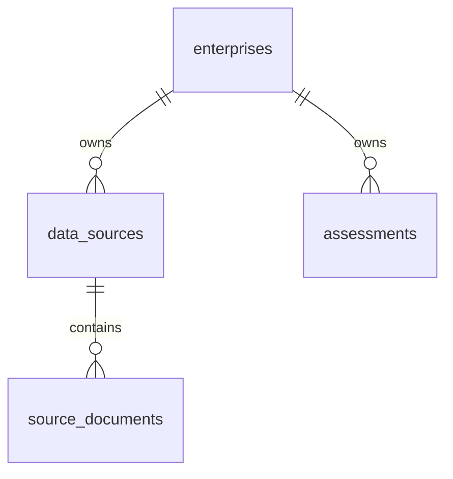

# طراحی پیشنهادی PostgreSQL برای MVP

این طراحی یک پیشنهاد قابل بازبینی است؛ هیچ migration اجرا نشده است. داده نمونه و نتیجه علمی وارد این schema نمی‌شوند. شواهد دامنه در [موجودی داده](DATA_MODEL_INVENTORY.md) و `composables/useMockStore.ts` آمده است.

## قواعد مشترک

شناسه‌ها `integer GENERATED BY DEFAULT AS IDENTITY` هستند تا با `number` فعلی فرانت‌اند سازگار باشند. همه جدول‌ها `created_at timestamptz NOT NULL DEFAULT now()` و `updated_at timestamptz NOT NULL DEFAULT now()` دارند؛ Sequelize مسئول به‌روزرسانی دومی است. نام ستون‌ها snake_case و نام JSONها camelCase است. متن اختیاری خالی پس از trim به null تبدیل می‌شود. محدودیت‌های طول زیر فرض‌های MVP هستند، نه قواعد کشف‌شده علمی.

### enterprises

| ستون | نوع و محدودیت | توضیح |
|---|---|---|
| id | integer PK | شناسه |
| name | varchar(200) NOT NULL، CHECK length(btrim(name)) > 0 | نام |
| industry | varchar(200) NOT NULL، CHECK length(btrim(industry)) > 0 | صنعت |
| description | text NULL | توضیح، حداکثر 10000 کاراکتر در validation |
| country | varchar(120) NULL | کشور |
| business_model | varchar(120) NULL | مدل کسب‌وکار |
| company_size | varchar(20) NULL | اندازه، از گزینه‌های فرم فعلی |

نام سازمان unique نیست: تشابه نام الزاماً هویت یکسان نیست. `logo` فعلی فقط placeholder است و جریان مدیریت تصویر ندارد. مرتب‌سازی پیش‌فرض با index روی `(created_at DESC, id DESC)`.

### data_sources

| ستون | نوع و محدودیت | توضیح |
|---|---|---|
| id | integer PK | شناسه |
| enterprise_id | integer NOT NULL FK enterprises(id) ON DELETE RESTRICT | مالک |
| name | varchar(200) NOT NULL، CHECK length(btrim(name)) > 0 | نام |
| type | varchar(32) NOT NULL CHECK در فهرست زیر | نوع منبع |
| enabled | boolean NOT NULL DEFAULT true | فعال بودن metadata، نه اتصال واقعی |
| description | text NULL | حداکثر 10000 کاراکتر |
| business_text | text NULL | حداکثر 50000 کاراکتر؛ فقط business_document |

type یکی از `clarity`, `matomo`, `support`, `business_document`, `capability_excel`, `server_log`, `event_log`, `custom` است. CHECK اجازه business_text غیر null را فقط برای `business_document` می‌دهد. نام تکراری مجاز است. index روی `(enterprise_id, created_at DESC, id DESC)` و `(enterprise_id, enabled)`؛ type پس از ایجاد تغییر نمی‌کند.

### source_documents

| ستون | نوع و محدودیت | توضیح |
|---|---|---|
| id | integer PK | شناسه |
| data_source_id | integer NOT NULL FK data_sources(id) ON DELETE RESTRICT | منبع |
| storage_key | uuid NOT NULL UNIQUE | نام داخلی فایل، هرگز مسیر ورودی کاربر نیست |
| original_name | varchar(255) NOT NULL | نام نمایشی بدون مسیر |
| media_type | varchar(100) NOT NULL | نوع ادعایی/تشخیص‌داده‌شده مجاز |
| size_bytes | integer NOT NULL CHECK (size_bytes > 0 AND size_bytes <= 20971520) | حداکثر 20 MiB پیشنهادی |
| sha256 | char(64) NOT NULL CHECK مطابق hex lowercase | صحت محتوا، نه versioning |

index روی `(data_source_id, created_at DESC, id DESC)`. فقط سرویس در transaction و با قفل منبع از نوع `business_document` اجازه درج می‌دهد. PDF، DOCX و TXT مجاز؛ کنترل پسوند، MIME و امضای قابل تشخیص، بدون اجرای محتوا یا parsing. این محدودیت‌ها پیشنهاد عملیاتی‌اند و پیش از اجرا قابل بازبینی‌اند.

### assessments

| ستون | نوع و محدودیت | توضیح |
|---|---|---|
| id | integer PK | شناسه |
| enterprise_id | integer NOT NULL FK enterprises(id) ON DELETE RESTRICT | مالک |
| name | varchar(200) NOT NULL، CHECK length(btrim(name)) > 0 | عنوان |
| description | text NULL | حداکثر 10000 کاراکتر |
| version | varchar(40) NOT NULL DEFAULT '1.0'، CHECK length(btrim(version)) > 0 | برچسب ورودی کاربر |
| status | varchar(16) NOT NULL DEFAULT 'draft' CHECK status = 'draft' | تنها وضعیت واقعی MVP |

index روی `(enterprise_id, created_at DESC, id DESC)`. امتیاز، completedAt، evidence و pipeline در محیط واقعی وجود ندارند. نسخه لزوماً unique نیست و snapshot یا dataset version نیست.

## حذف، فایل و migration

برای جلوگیری از حذف ناقص و حفظ قابلیت بازیابی، حذف سازمان دارای منبع یا ارزیابی و حذف منبع دارای سند `409 RESOURCE_NOT_EMPTY` است؛ UI وابستگی را توضیح می‌دهد. این تغییر از cascade شبیه‌سازی فعلی آگاهانه است و پیش از پیاده‌سازی باید بررسی شود. سند به‌طور مستقل حذف می‌شود. حذف assessment در UI فعلی وجود ندارد؛ حذف سازمان دارای draft نیازمند API حذف draft و افزودن action UI است.

فایل در مسیر موقت خصوصی، با محدودیت جریان و hash نوشته می‌شود؛ سپس با نام تصادفی به محل نهایی منتقل و metadata درج می‌شود. در شکست درج، فایل پاک شود؛ هنگام crash، فایل بدون metadata در startup یا دستور نگهداری با grace period شناسایی و پاک شود. حذف ابتدا فایل را به quarantine در همان filesystem منتقل و سپس رکورد را حذف کند؛ پس از commit فایل quarantine حذف شود. شکست transaction به بازگرداندن فایل می‌انجامد؛ crash بین مراحل با reconciliation و ثبت خطا بررسی می‌شود. عملیات filesystem و PostgreSQL transaction اتمیک مشترک ندارند؛ backup باید هر دو را با هم پوشش دهد.

قرارداد نام‌گذاری و بازیابی: مسیر نهایی `objects/<storage-key>`، مسیر موقت `staging/<storage-key>` و قرنطینه `quarantine/<storage-key>` است؛ همه زیر یک root خصوصی و روی یک filesystem هستند. حذف با قفل ردیف سند در transaction، انتقال اتمیک به quarantine، حذف رکورد، commit و سپس پاک‌کردن quarantine انجام می‌شود؛ عملیات همزمان روی یک storage key با advisory lock مختص کلید سریالی شوند. بازیابی، تنها پس از توقف writerها، برای هر کلید بررسی می‌کند: رکورد موجود و فایل فقط در quarantine ⇒ بازگرداندن؛ رکورد ناموجود و فایل در quarantine ⇒ پاک‌کردن؛ فایل نهایی بدون رکورد و قدیمی‌تر از grace period ⇒ پاک‌کردن؛ رکورد موجود و فایل در هیچ‌یک ⇒ خطای صریح و هشدار، نه حذف رکورد. وجود همزمان دو نسخه یا هر حالت نامشخص فقط گزارش می‌شود. upload نام storage key را پیش از نوشتن ایجاد می‌کند؛ orphan staging قدیمی پس از تأیید توقف writerها پاک می‌شود. بازگردانی backup نیز باید ابتدا با writer متوقف reconcile شود. آزمون crash در هر مرز برای پذیرش T05 الزامی است.

ترتیب migration: 01 enterprises، 02 data_sources، 03 source_documents، 04 assessments؛ down به ترتیب معکوس و صرفاً برای محیط توسعه. Sequelize associations به ترتیب `hasMany/belongsTo` متناظر ERD و `onDelete: RESTRICT`.

## Seed و دمو

محیط واقعی و توسعه عادی با دیتابیس خالی شروع می‌شود. seed نمایشی فقط با متغیر صریح `APP_MODE=demo`، اتصال به دیتابیس مجزا و بررسی نام دیتابیس با پسوند `_demo` مجاز است؛ در غیر این صورت fail closed. seed تکرارپذیر باید رکوردهای متعلق به fixture را با شناسه پایدار مدیریت کند و هیچ فایل ناموجودی را آپلودشده نشان ندهد. داده نتیجه، evidence و capability از fixtureهای ثابت دمو در Frontend خوانده می‌شوند، نه از جداول واقعی نتیجه؛ سازمان و منابع دمو از API دیتابیس مجزای دمو می‌آیند. Wizard دمو فقط روی fixture مستقل با شناسه‌های ثابت اجرا و با برچسب نمایشی مشخص می‌شود و حق نوشتن نتیجه در API واقعی ندارد. دیتابیس دمو برای metadata و draftها است؛ مقادیر نتیجه نمایشی در fixture محلی دمو هستند.
