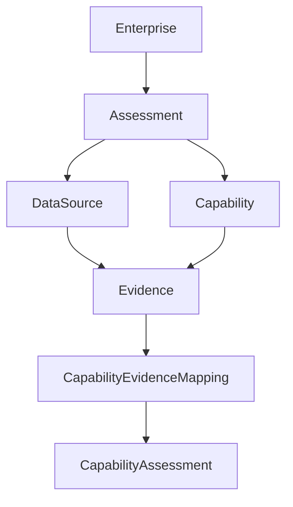

## معماری داده (بر اساس data.pdf)

- `Capability` (درخت، مستقل از Assessment) و `Evidence` (خام، بدون ساختار ثابت) از قبل در `[types/capability.ts](c:\saba\maturity-app\types\capability.ts)` و `[types/evidence.ts](c:\saba\maturity-app\types\evidence.ts)` تعریف شده‌اند.
- `CapabilityEvidenceMapping` خروجی AI شماره ۱ (`confidence` بازه ۰-۱)، `CapabilityAssessment` خروجی AI شماره ۲ (`score`/`maturityLevel` روی مقیاس لیکرت ۱-۵). Parent Capabilityها از میانگین فرزندها محاسبه می‌شوند، نه توسط AI.
- امتیازها باید در همه‌جا (Types, Mock, UI) به لیکرت ۱-۵ تبدیل شوند؛ فعلاً `overallScore` و مثال‌های Mock به شکل درصد (۷۸، ۸۲) نوشته شده‌اند که باید اصلاح شوند (مثلاً `3.8`, `4.1`).

## فاز ۰ — هم‌راستاسازی Types + Mock مرکزی

- اصلاح `[types/assessment.ts](c:\saba\maturity-app\types\assessment.ts)`: افزودن `version: string`.
- اصلاح `[types/datasource.ts](c:\saba\maturity-app\types\datasource.ts)`: نوع‌ها را با data.pdf یکسان کنیم (`clarity`, `matomo`, `support`, `business_document`, `capability_excel`, `server_log`, `event_log`, `custom`).
- بازبینی `[types/mapping.ts](c:\saba\maturity-app\types\mapping.ts)` و `[types/assessment-result.ts](c:\saba\maturity-app\types\assessment-result.ts)`: مطمئن شویم `confidence` (۰-۱) و `score`/`maturityLevel` (۱-۵) به‌درستی تایپ شده‌اند؛ کامنت مستندسازی کوتاه اضافه شود.
- ساخت پوشه `mock/` با فایل‌های جدا: `enterprise.ts`, `capabilities.ts`, `data-sources.ts`, `assessments.ts`, `evidence.ts`, `mappings.ts`, `capability-assessments.ts`, `pipeline.ts`. یک Enterprise واحد (Vornaco) کافی است.
- درخت Capability نمونه: `Business → Customer Experience → Reporting → Submit Report` (چند سطح، هر Leaf چند Evidence Mapping دارد).
- حذف Mock پراکنده از `[pages/enterprise/[id]/index.vue](c:\saba\maturity-app\pages\enterprise\[id]\index.vue)` و `[pages/enterprise/[id]/data-sources.vue](c:\saba\maturity-app\pages\enterprise\[id]\data-sources.vue)` و اتصال به `mock/`.
- اصلاح `[components/assessment/Card.vue](c:\saba\maturity-app\components\assessment\Card.vue)`: نمایش امتیاز به‌صورت `x.x / 5` به‌جای `%`.

## فاز ۱ — رفع کامپوننت‌های گم‌شده

`[components/assessment/Detail.vue](c:\saba\maturity-app\components\assessment\Detail.vue)` به کامپوننت‌های ناموجود ارجاع می‌دهد:
- `AssessmentOverviewCard` → در واقع باید نگاشت شود به `[components/assessment/Card.vue](c:\saba\maturity-app\components\assessment\Card.vue)`‌ محتوای مشابه (Overview) - یا rename برای وضوح.
- `AssessmentPipelineCard` → موجود است به‌عنوان `[components/assessment/pipeline/Card.vue](c:\saba\maturity-app\components\assessment\pipeline\Card.vue)` (auto-import می‌شود به `AssessmentPipelineCard`)، فقط اسم فایل باید مطابقت داشته باشد یا Detail.vue اصلاح شود.
- `EmptyAssessment` باید ساخته شود (`components/assessment/Empty.vue`).
- پاکسازی نشانگرهای دیباگ در `[components/assessment/pipeline/Step.vue](c:\saba\maturity-app\components\assessment\pipeline\Step.vue)` خطوط ۴۳-۴۸ (سه `div` رنگی بی‌مصرف).

## فاز ۲ — صفحه Assessments یکپارچه (List + Detail + Run)

مسیر: `/enterprise/[id]/assessments` (بدون route جدا برای هر Assessment - طبق تصمیم کاربر).

- ساختار مشابه `[pages/enterprise/[id]/assessments.vue](c:\saba\maturity-app\pages\enterprise\[id]\assessments.vue)` فعلی: لیست سمت چپ (`AssessmentList`)، جزئیات سمت راست (`AssessmentDetail`).
- دکمه «New Assessment» یک فرم/مودال کوچک باز می‌کند (name, description, version) و یک `Assessment` جدید با status `draft` می‌سازد.
- دکمه «Run Assessment» pipeline را با status `running` شروع می‌کند و با `setInterval`/`setTimeout` هر Step را به ترتیب:
  `collect_sources → extract_evidence → mapping → assessment → aggregation → report`
  از `waiting` به `running` به `completed` می‌برد (هر مرحله ۱.۵-۲.۵ ثانیه، انیمیشن‌دار با آیکون در حال چرخش که همان الگوی `[components/assessment/pipeline/Step.vue](c:\saba\maturity-app\components\assessment\pipeline\Step.vue)` است).
- وقتی Step فعلی `mapping` یا `assessment` است (مراحل AI)، در همان کارت Pipeline جزئیات بیشتری نشان داده شود (مثلاً تعداد Evidence در حال Map شدن) تا حس «تحلیل چند مرحله‌ای» القا شود؛ می‌توان یک لیست کوچک زیرمرحله‌ها (sub-steps نمایشی، صرفاً UI) داخل کارت مربوط اضافه کرد.
- در پایان Pipeline: `Assessment.status = completed`, `overallScore` محاسبه‌شده (میانگین وزنی Mock)، و دکمه **«View Full Report»** ظاهر می‌شود که به بخش Results در همان صفحه اسکرول می‌کند یا Accordion را باز می‌کند (طبق تصمیم کاربر: «آخرش یه دکمه برای ریپورت کامل اگه تموم شده باشه» - بدون route جدا).
- منطق pipeline animation در یک composable قرار گیرد: `composables/useAssessmentPipeline.ts`.

## فاز ۳ — بخش Results (داخل همان صفحه Assessment، بعد از تکمیل)

طبق اولویت کاربر، این چهار مورد را می‌سازیم (بقیه از قبیل Radar بعداً):

1. **Capability Tree** - کامپوننت `components/capability/Tree.vue`، درختی تاشونده (Business → Customer Experience → ...)، رنگ هر Node بر اساس `maturityLevel` (Green/Yellow/Orange/Red).
2. **Score Table** - `components/capability/ScoreTable.vue` با ستون‌های Name, Level, Score, Confidence, Evidence Count؛ استفاده از `UiDataTable` موجود.
3. **Heatmap تعاملی** - `components/capability/Heatmap.vue`؛ Level 1 → click → Level 2 → click → Leaf، هر سطح Grid رنگی؛ کلیک باز کردن جزئیات Leaf (Evidence + Reasoning) در یک پنل/مودال کناری.
4. **Timeline نمایشی** - `components/assessment/Timeline.vue`؛ نمایش Assessmentهای گذشته یک Enterprise با نقاط روی خط زمان و overallScore هر کدام (از Mock چند Assessment).

این چهار بخش به‌صورت Tabs یا Accordion داخل `AssessmentDetail` بعد از Pipeline کامل قرار می‌گیرند.

## فاز ۴ — Evidence و AI Mapping به‌عنوان جزئیات Pipeline (نه صفحه جدا)

طبق تصمیم کاربر (سوال ۴)، Evidence Explorer و AI Mapping صفحه مستقل ندارند؛ بلکه:
- روی مرحله `extract_evidence` کلیک/باز شدن → نمایش لیست Evidence استخراج‌شده (از `mock/evidence.ts`) در یک Panel/Drawer.
- روی مرحله `mapping` → نمایش لیست `CapabilityEvidenceMapping` با confidence/reasoning، امکان Approve/Reject (فقط UI state، بدون Backend).
هر دو به‌عنوان expandable content داخل `[components/assessment/pipeline/Step.vue](c:\saba\maturity-app\components\assessment\pipeline\Step.vue)` (کلیک روی step کامل‌شده جزئیاتش را نشان دهد).

## فاز ۵ — Data Source: Business Documentation

طبق تصمیم کاربر (۶=a): یک Data Source از نوع `business_document` با UI ویژه:
- در `[pages/enterprise/[id]/data-sources.vue](c:\saba\maturity-app\pages\enterprise\[id]\data-sources.vue)`، هنگام افزودن/ویرایش این نوع، فرم شامل textarea توضیح بیزینس + دکمه Upload (Mock، فقط نام فایل ذخیره می‌شود، بدون آپلود واقعی).

## فاز ۶ — Dashboard (ساده)

طبق تصمیم کاربر (۱=B): `[pages/index.vue](c:\saba\maturity-app\pages\index.vue)` به یک صفحه ساده تبدیل شود:
- خلاصه Enterprise (نام، صنعت)
- آخرین Assessment و امتیاز آن
- تعداد Data Sourceهای فعال
- دکمه/لینک به `/enterprise/1`

## فاز ۷ — Reports Tab

مسیر: `/enterprise/[id]/reports` (صفحه جدید).
- لیست Assessmentهایی با status `completed` (از `UiDataTable`) با ستون Name, Date, Score.
- هر ردیف لینک/دکمه «View» → می‌برد به همان صفحه Assessments با آن Assessment انتخاب‌شده (چون route جدا برای Report نداریم)، یا دکمه Print مستقیم.
- عنوان تب «Reports» در `[components/enterprise/Tabs.vue](c:\saba\maturity-app\components\enterprise\Tabs.vue)` از قبل موجود است، فقط صفحه ساخته می‌شود.

## فاز ۸ — Enterprise CRUD (اولویت پایین، برای آینده)

طبق پاسخ کاربر («در نهایت لازم داریمش») - آخرین فاز:
- `pages/enterprise/index.vue` (لیست، فعلاً یک ردیف Vornaco)
- فرم Create/Edit (Company Name, Description, Industry, Country, Business Type, Company Size) با `UiInput`/`UiTextarea`/`UiSelect` موجود.
- توجه: فیلدهای متنی کاربر (نام/توضیحات) باید `dir="auto"` بگیرند تا فارسی/انگلیسی به‌درستی نمایش داده شوند (RTL/LTR خودکار طبق تصمیم کاربر).

## نکات فنی کلی

- زبان UI انگلیسی می‌ماند؛ فقط ورودی‌های کاربر (نام/توضیح Enterprise) چندزبانه با `dir="auto"`.
- بدون Backend/API/Auth/LLM واقعی؛ همه چیز Mock و تعاملات فقط در حافظه (ref/composable) شبیه‌سازی می‌شود.
- کامپوننت‌ها Auto-Import هستند؛ نام‌گذاری باید دقیقاً با پوشه/فایل مطابقت داشته باشد تا Detail.vue کار کند.
- بدون کتابخانه Chart سنگین برای فاز فعلی؛ Heatmap/Tree/Timeline با Tailwind + SVG ساده پیاده می‌شوند تا وابستگی اضافه نشود (Radar Chart با کتابخانه سبک به فازهای بعدی موکول می‌شود).

## ترتیب اجرا (PRها)

1. PR-0: Types + Mock مرکزی + اصلاح امتیاز به لیکرت ۱-۵
2. PR-1: رفع کامپوننت‌های گم‌شده در Assessment Detail/Pipeline
3. PR-2: Run Assessment (Pipeline زنجیره‌ای متحرک) + composable
4. PR-3: Evidence/Mapping به‌عنوان جزئیات Step
5. PR-4: Results (Capability Tree, Score Table, Heatmap, Timeline)
6. PR-5: Data Source Business Documentation
7. PR-6: Dashboard ساده
8. PR-7: Reports Tab
9. PR-8: Enterprise CRUD (پایین‌ترین اولویت)