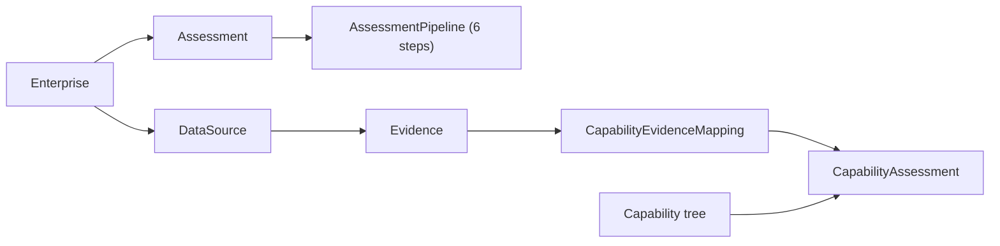

# What has been built so far

A full mock-data-driven Nuxt 4 frontend for an AI Capability Maturity Assessment Platform. No backend/API calls — everything lives in an in-memory reactive store (`composables/useMockStore.ts`) seeded from `mock/*.ts`.

Core flows implemented end-to-end:
1. Dashboard (`/`) with platform-wide stats.
2. Enterprise CRUD (list/create/delete) — no edit yet.
3. Enterprise overview, data sources (CRUD + toggle + business doc), assessments, reports — 4 tabs via `components/enterprise/Tabs.vue`.
4. A 4-step **Assessment Wizard** ("Review Setup" → "Evidence & Mapping" → "AI Analysis" → "Results") that is the centerpiece feature.
5. A full **Assessment Report** page reusing the same results components (capability tree, interactive nested heatmap, score table, evidence, AI reasoning, recommendations).
6. Every `.vue`/`.ts` file now has an English header comment describing its purpose (just completed).

# Architecture recap

Data flows entirely through [composables/useMockStore.ts](composables/useMockStore.ts), a module-level singleton (refs declared outside the composable function so state persists across component instances). Two near-duplicate route helpers exist — [composables/useEnterpriseRoute.ts](composables/useEnterpriseRoute.ts) and [composables/useEnterpriseContext.ts](composables/useEnterpriseContext.ts) — both resolve `enterpriseId`/`enterprise`/`assessments`/`dataSources` from the current route; only `useEnterpriseRoute` is actually used by pages today, so `useEnterpriseContext` is dead code.

# File-by-file map

## Pages (`pages/`)
- [pages/index.vue](pages/index.vue) — Dashboard: aggregate stats + quick links.
- [pages/enterprise/index.vue](pages/enterprise/index.vue) — Enterprise list (`UiDataTable`) with create (modal) and delete.
- [pages/enterprise/[id]/index.vue](pages/enterprise/[id]/index.vue) — Enterprise overview: info card, latest assessment, maturity score, quick stats.
- [pages/enterprise/[id]/data-sources.vue](pages/enterprise/[id]/data-sources.vue) — Data source table with add/edit modals, enable toggle, delete, business-document context.
- [pages/enterprise/[id]/assessments/index.vue](pages/enterprise/[id]/assessments/index.vue) — Assessment list + detail sidebar; `?id=` query sync; create modal routes into the wizard.
- [pages/enterprise/[id]/assessments/[assessmentId]/index.vue](pages/enterprise/[id]/assessments/[assessmentId]/index.vue) — Redirect shim to `/run` or `/report` based on status.
- [pages/enterprise/[id]/assessments/[assessmentId]/run.vue](pages/enterprise/[id]/assessments/[assessmentId]/run.vue) — Hosts the 4-step wizard (`useAssessmentWizard`).
- [pages/enterprise/[id]/assessments/[assessmentId]/report.vue](pages/enterprise/[id]/assessments/[assessmentId]/report.vue) — Full report: card, pipeline, timeline, results.
- [pages/enterprise/[id]/reports.vue](pages/enterprise/[id]/reports.vue) — List of completed assessments with print action.

## Wizard (`components/assessment/wizard/`)
- `Shell.vue` — progress bar + 4-step indicator.
- `StepReview.vue` — capability tree, data sources, business docs; "Confirm & Continue".
- `StepEvidence.vue` — evidence stats, unmapped-leaf warning, grouped AI mappings with Approve/Don't Consider/Not Related actions.
- `StepAiLoading.vue` — animated fake AI progress (setInterval-driven).
- `StepResults.vue` — final score + reuse of `AssessmentResults` + link to full report.
- `CapabilityNode.vue` — recursive tree row for the review step.

## Capability visualizations (`components/capability/`)
- `Tree.vue` / `TreeNode.vue` — collapsible hierarchical score tree.
- `Heatmap.vue` / `HeatmapNode.vue` — click-to-expand nested tile heatmap (just redesigned per latest feedback: soft colors, `@click.stop` fix for nested toggling).
- `ScoreTable.vue` — flat table of scores/confidence/evidence count.

## Assessment (`components/assessment/`)
- `Card.vue`, `Detail.vue`, `List.vue`, `ListItem.vue`, `NewModal.vue`, `Timeline.vue`, `Results.vue`, `pipeline/Card.vue`, `pipeline/Step.vue`.

## Enterprise (`components/enterprise/`)
- `Header.vue` (emits `edit` — **currently unhandled**), `Tabs.vue`, `InformationCard.vue`, `LatestAssessmentCard.vue`, `AssessmentSummaryCard.vue`, `MaturityCard.vue`, `DataSourceCard.vue`, `DataSourceStats.vue`, `NewModal.vue`, `QuickActionCard.vue` (static, unused placeholder).

## UI kit (`components/ui/`) and shell (`components/app/`)
Generic primitives (`Badge`, `Button`, `Input`, `Select`, `Textarea`, `DataTable`, `EmptyState`) and the app shell (`Sidebar`, `Header`, `Breadcrumb`, `Search`, `Notifications`, `UserMenu`, `Logo`, `Card`, `Container`, `DescriptionItem..vue`).

## Data layer
- `types/*` — domain model (Enterprise, DataSource, Assessment, Capability, CapabilityAssessment, Evidence, CapabilityEvidenceMapping, AssessmentPipeline, wizard/UI types).
- `mock/*` — seed data + "template generator" functions (`getTemplateEvidence`, `getTemplateMappings`, `getTemplateCapabilityAssessments`, `getTemplateRecommendations`) that clone assessment #1's data for any newly run assessment.
- `utils/*` — formatting/label/color helpers. Note: `utils/format.ts` (`getDataSourceTypeLabel`) is dead code superseded by `utils/data-source.ts` (`getDataSourceLabel`), and has slightly different/wrong enum keys (`capability_document`, `support_ticket`, `customer_feedback` don't match `DataSourceType`).
- `composables/useMockStore.ts` — the mock backend: CRUD + `runAssessment` (legacy auto-run) + wizard-specific step functions (`startWizardAssessment`, `prepareWizardEvidence`, `finalizeWizardAssessment`, `updateMappingReview`).

# Known gaps / inconsistencies found during this review

1. **Enterprise edit** — `EnterpriseHeader` emits `edit`, but no page listens for it or opens an edit form/modal. `useMockStore.updateEnterprise` already exists and is unused.
2. **Dead/duplicate code** — `composables/useEnterpriseContext.ts` (unused duplicate of `useEnterpriseRoute`), `utils/format.ts` (unused, and incorrect enum values), `components/enterprise/QuickActionCard.vue` (static buttons with no click handlers, not referenced by any page).
3. **No radar chart** — deferred earlier; capability comparison is currently tree/heatmap/table only.
4. **No enterprise-level maturity trend across multiple enterprises** — dashboard only looks at `enterprises[0]`.
5. **Legacy `runAssessment` pipeline auto-run** in the store (used nowhere now that the wizard drives everything) vs. the wizard's own `startWizardAssessment`/`prepareWizardEvidence`/`finalizeWizardAssessment` — two parallel "run" implementations exist; only the wizard path is reachable from the UI today.
6. **No delete/duplicate assessment action** from the assessments list UI (store method exists: `deleteAssessment`).
7. **No form validation feedback** (e.g. required-field errors) in New Enterprise / New Assessment / New Data Source modals — silently no-ops if required fields are blank.

# Proposed next steps to close out the MVP frontend

1. **Enterprise edit** — add an edit modal (reuse `EnterpriseNewModal` pattern) wired to `EnterpriseHeader`'s `edit` event and `store.updateEnterprise`.
2. **Clean up dead code** — remove `useEnterpriseContext.ts`, `utils/format.ts`, and either wire up or remove `QuickActionCard.vue`.
3. **Assessment list actions** — add delete (and maybe duplicate) to `AssessmentListItem`/`AssessmentDetail`, backed by existing `deleteAssessment`.
4. **Basic form validation UI** — show inline error text (already supported by `UiInput`/`UiTextarea`/`UiSelect` `error` prop) when required fields are empty on submit attempts.
5. **Radar chart** (if still wanted for MVP) — add a capability radar/spider chart component (e.g. lightweight SVG or a small chart lib) next to the heatmap on the report page, comparing level-1 capability scores.
6. **Polish pass** — loading/disabled states on buttons during async actions (`runAssessment`/wizard steps), and confirm all `dir="auto"` usages cover every user-entered free-text field consistently.
7. **Multi-enterprise dashboard** — decide whether the dashboard should aggregate across all enterprises or keep the "first enterprise" shortcut (currently a simplification).

Each of these is independently scoped; recommend tackling 1–4 first since they're small, self-contained, and remove real UX gaps, then discuss whether 5–7 are in scope for this MVP phase.
